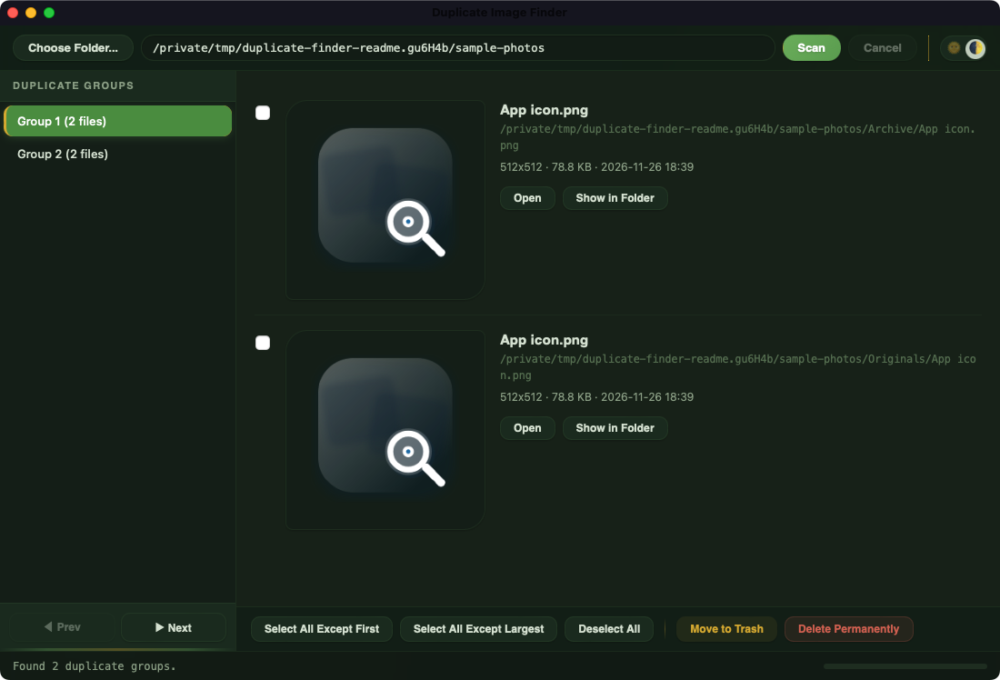

# Duplicate Image Finder

A Tauri v2 desktop app for finding and managing exact duplicate image files. It uses a Rust backend and a single-file HTML, CSS, and JavaScript frontend.

[Release notes](https://github.com/rupertgermann/duplicateFinder/releases)

## Screenshots

### Welcome screen


### Duplicate groups



## Features

- Recursive folder scanning with parallel MD5 hashing
- Sidebar navigation with **Prev** and **Next** controls for duplicate groups
- Cached thumbnails up to 250 × 250 pixels, with each file's name, full path, dimensions, size, and modification time
- Selection helpers for keeping the first or largest file in a group
- Per-file actions for opening an image or showing it in the system file manager
- Group actions for moving selected files to Trash or deleting them permanently
- Scan progress, cancellation, and a count of skipped items
- Dark theme by default, with a light theme option and a remembered preference

## Supported files

The scanner treats the following extensions as image files:

`jpg`, `jpeg`, `png`, `gif`, `bmp`, `tiff`, `tif`, `webp`, `heic`, `heif`, `avif`, `ico`

Thumbnails and dimensions are available for JPEG, PNG, GIF, BMP, TIFF, WebP, and ICO files that the app can decode.

Files that the app cannot decode still participate in duplicate detection. The app shows **?** for unknown dimensions and **No preview** when thumbnail generation fails.

## Requirements

- [Rust toolchain](https://rustup.rs/) (stable)
- [Node.js](https://nodejs.org/) and npm
- [Tauri v2 system dependencies for your operating system](https://v2.tauri.app/start/prerequisites/)

## Setup

```bash
git clone https://github.com/rupertgermann/duplicateFinder.git
cd duplicateFinder
npm ci
```

## Commands

| Command | Description |
| --- | --- |
| `npm run dev` | Start the Tauri app in development mode. |
| `npm run build` | Build the release executable. |
| `npm run build -- --bundles app` | Build the macOS `.app` bundle. |
| `npm run tauri -- <args>` | Pass any additional Tauri CLI command or option through npm. |
| `cargo test --manifest-path src-tauri/Cargo.toml --locked` | Run the Rust tests. |

With Cargo's default target directory, the release executable is at `src-tauri/target/release/duplicate-finder` (with `.exe` on Windows). The macOS bundle is at `src-tauri/target/release/bundle/macos/DuplicateImageFinder.app`.

## Usage

1. Click **Choose Folder...** or enter the folder path.
2. Click **Scan**. The status bar shows progress, errors, and the number of skipped items in a partial scan. Click **Cancel** to stop an active scan.
3. Choose a duplicate group in the sidebar. Use **Open** or **Show in Folder** to inspect a file.
4. Select the files to remove. Use **Select All Except First** or **Select All Except Largest** to keep one file. Use **Deselect All** to clear the selection.
5. Click **Move to Trash** or **Delete Permanently**, then review the confirmation. Selecting every file manually adds a warning that the action removes the entire group.

## How scanning and removal work

- The scanner follows directory symlinks, visits each directory once, and skips file symlinks.
- Groups contain files with matching MD5 hashes. The app sorts groups by file count, largest first, then by the first file's path. It sorts files within each group by path.
- **Select All Except Largest** keeps the first file in path order when sizes tie.
- Before removal, the app checks that each selected file still matches the scan. Unless you confirm removal of the whole group, it also checks for an unchanged, byte-for-byte matching file to keep. When you use a selection helper, the app checks the file chosen by that helper.
- The status bar reports removal failures. Successful removals update the affected group immediately. Groups with fewer than two files disappear from the list.
- **Move to Trash** reports a per-file error for paths containing invalid UTF-8 on macOS and paths that need a verbatim prefix on Windows, including UNC network paths.

## Architecture

- The frontend contains the layout, styles, and UI event handlers. [`src/index.html`](src/index.html)
- The Rust backend handles scans, thumbnails, file actions, and Tauri setup. [`src-tauri/src/lib.rs`](src-tauri/src/lib.rs)

The frontend calls `scan_folder`, `cancel_scan`, `get_thumbnail`, `trash_files`, `delete_files`, `open_file`, and `reveal_file`. The backend emits `scan-progress` events to update the status bar and progress bar.

## Project structure

```text
duplicateFinder/
├── docs/
│   ├── agents/
│   └── screenshots/
│       ├── main-view.png
│       └── welcome.png
├── src/
│   └── index.html
├── src-tauri/
│   ├── capabilities/
│   │   └── default.json
│   ├── gen/
│   ├── icons/
│   ├── src/
│   │   ├── lib.rs
│   │   └── main.rs
│   ├── build.rs
│   ├── Cargo.lock
│   ├── Cargo.toml
│   └── tauri.conf.json
├── LICENSE
├── README.md
├── package-lock.json
└── package.json
```

## License

[MIT](LICENSE)
