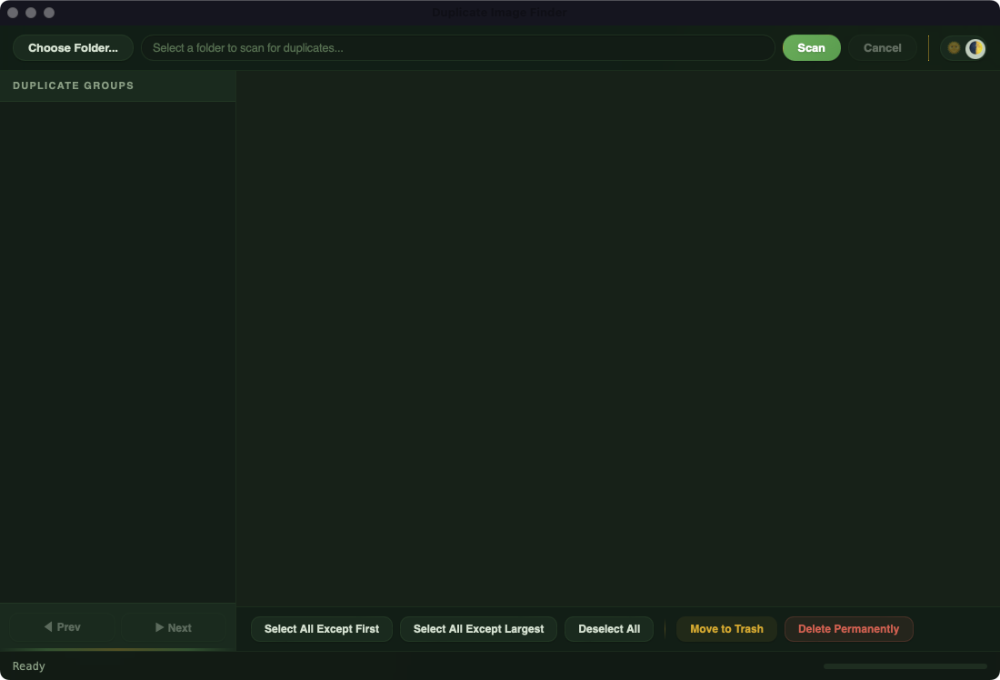

# Duplicate Image Finder

A Tauri v2 desktop app for finding and managing exact duplicate image files on macOS, Windows, and Linux. It scans local folders with a Rust backend and an HTML, CSS, and JavaScript frontend.

[Release notes](https://github.com/rupertgermann/duplicateFinder/releases)

## Download for macOS

On an Apple Silicon Mac, unzip the download and drag **DuplicateImageFinder.app** to **Applications**. [Download the macOS ZIP](https://github.com/rupertgermann/duplicateFinder/releases/latest/download/DuplicateImageFinder-macOS.zip) · [SHA-256 checksum](https://github.com/rupertgermann/duplicateFinder/releases/latest/download/DuplicateImageFinder-macOS.zip.sha256)

The app uses an ad-hoc signature. If macOS blocks the app on first launch, see [Apple's guidance for opening trusted apps](https://support.apple.com/en-us/102445#openanyway).

## Screenshots

### Welcome screen



### Duplicate groups


## Social preview

Use this image in the repository's **Social preview** settings on GitHub. [Download the 1200 × 630 JPEG](docs/screenshots/social-preview.jpg).

## Features

- Recursive folder scanning with a file-size filter, parallel MD5 hashing, and byte-for-byte verification
- Sidebar navigation with **Prev** and **Next** controls for duplicate groups
- One shared thumbnail up to 250 × 250 pixels per group, with each file's name, full path, dimensions, size, and modification time in UTC
- A selection shortcut for keeping the first file in a group
- Per-file actions for opening an image or showing it in the system file manager
- Group actions for moving selected files to Trash or deleting them permanently
- Scan progress, cancellation, and a count of skipped items
- Dark theme by default, with a toolbar theme switch, a remembered preference, and bundled fonts that work offline

## Supported files

The scanner matches these file extensions without regard to case.

`jpg`, `jpeg`, `png`, `gif`, `bmp`, `tiff`, `tif`, `webp`, `heic`, `heif`, `avif`, `ico`

The app can decode JPEG, PNG, GIF, BMP, TIFF, WebP, and ICO. The group preview checks the file contents to identify the format and falls back to the extension, including for BigTIFF files. It can use another copy in the group if a file changes or becomes unavailable.

Duplicate detection also covers files the app cannot decode, including HEIC, HEIF, and AVIF. The app shows **?** for unknown dimensions and **No preview** when it cannot generate the group thumbnail.

## Requirements

- [Rust toolchain](https://rustup.rs/) (stable)
- [Node.js](https://nodejs.org/) and npm
- [Tauri v2 system dependencies for your operating system](https://v2.tauri.app/start/prerequisites/)

## Setup

```bash
git clone https://github.com/rupertgermann/duplicateFinder.git
cd duplicateFinder
npm ci
```

## Commands

| Command | Description |
| --- | --- |
| `npm run dev` | Start the Tauri app in development mode. |
| `npm run build` | Build the release executable. |
| `npm run build -- --bundles app` | Build the ad-hoc-signed macOS `.app` bundle. |
| `npm run tauri -- info` | Show the Tauri environment and project configuration. |
| `npm run tauri -- icon src-tauri/icons/icon-source.svg` | Generate the application icons from the source SVG. |
| `npm run tauri -- <args>` | Pass any additional Tauri CLI command or option through npm. |
| `cargo test --manifest-path src-tauri/Cargo.toml --locked` | Run the Rust tests. |

With Cargo's default target directory, the release executable is at `src-tauri/target/release/duplicate-finder` (with `.exe` on Windows). The macOS app bundle is at `src-tauri/target/release/bundle/macos/DuplicateImageFinder.app`.

Verify the app bundle signature before creating the distribution ZIP and its checksum.

```bash
mac_app=src-tauri/target/release/bundle/macos/DuplicateImageFinder.app
codesign --verify --strict "$mac_app" &&
  ditto -c -k --sequesterRsrc --keepParent "$mac_app" DuplicateImageFinder-macOS.zip &&
  shasum -a 256 DuplicateImageFinder-macOS.zip > DuplicateImageFinder-macOS.zip.sha256
```

Pass `--output` to the icon command to write the generated files to a separate directory.

## Usage

1. Click **Choose Folder...** or enter the folder path.
2. Click **Scan**. The status bar shows progress, errors, and the number of skipped items in a partial scan. Click **Cancel** to stop the scan and discard its results.
3. Choose a duplicate group in the sidebar. Use **Open** or **Show in Folder** to inspect a file. On Linux, both actions use `xdg-open` and **Show in Folder** opens the containing folder.
4. Select the files to remove. Use **Select All Except First** to keep the first file in path order. Use **Deselect All** to clear the selection.
5. Click **Move to Trash** or **Delete Permanently**, then review the confirmation. Selecting every file manually adds a warning that the action removes the entire group.

## How scanning and removal work

- The scanner follows directory symlinks, visits each directory once, and skips file symlinks and recovery folders nested under the selected folder.
- The scanner hashes files only when they share a size with another file. It then compares files with matching hashes byte for byte. The app sorts groups by file count, largest first, then by the first file's path. It sorts files within each group by path.
- Before removal, the app checks that each selected file still matches the scan. Unless you confirm removal of the whole group, it also checks for an unchanged, byte-for-byte matching file to keep. When you use **Select All Except First**, it checks that first file.
- The app validates each selected entry in a private recovery folder on the same volume before it moves the file to Trash or deletes it. See [File removal and recovery](docs/file-removal.md) for recovery steps and platform requirements.
- The status bar reports removal failures and details for the first failure. Successful removals update the affected group immediately. Groups with fewer than two files disappear from the list.

## Architecture

- The frontend contains the layout, styles, and UI event handlers. It caches up to 32 group thumbnails for the current scan. [`src/index.html`](src/index.html)
- The Rust backend handles scans, thumbnail generation, file actions, and Tauri setup. [`src-tauri/src/lib.rs`](src-tauri/src/lib.rs)
- The platform modules handle removal on Unix and Windows. Linux has a separate home Trash implementation. [Unix](src-tauri/src/file_removal_unix.rs), [Windows](src-tauri/src/file_removal_windows.rs), [Linux Trash](src-tauri/src/file_removal_linux.rs)

The frontend calls `scan_folder`, `cancel_scan`, `get_thumbnail`, `trash_files`, `delete_files`, `open_file`, and `reveal_file`. The backend emits `scan-progress` events to update the status bar and progress bar.

## Project structure

```text
duplicateFinder/
├── docs/
│   ├── agents/
│   ├── file-removal.md
│   └── screenshots/
│       ├── main-view.png
│       ├── social-preview.jpg
│       └── welcome.png
├── src/
│   ├── fonts/
│   └── index.html
├── src-tauri/
│   ├── capabilities/
│   │   └── default.json
│   ├── gen/
│   ├── icons/
│   ├── src/
│   │   ├── file_removal_linux.rs
│   │   ├── file_removal_unix.rs
│   │   ├── file_removal_windows.rs
│   │   ├── lib.rs
│   │   └── main.rs
│   ├── build.rs
│   ├── Cargo.lock
│   ├── Cargo.toml
│   └── tauri.conf.json
├── LICENSE
├── README.md
├── package-lock.json
└── package.json
```

## Support

Support development on [Patreon](https://patreon.com/rupertgermann) or [Buy Me a Coffee](https://buymeacoffee.com/rupertgermann).

## License

[MIT](LICENSE)

The bundled fonts have separate SIL Open Font License notices in [`src/fonts/`](src/fonts/).
